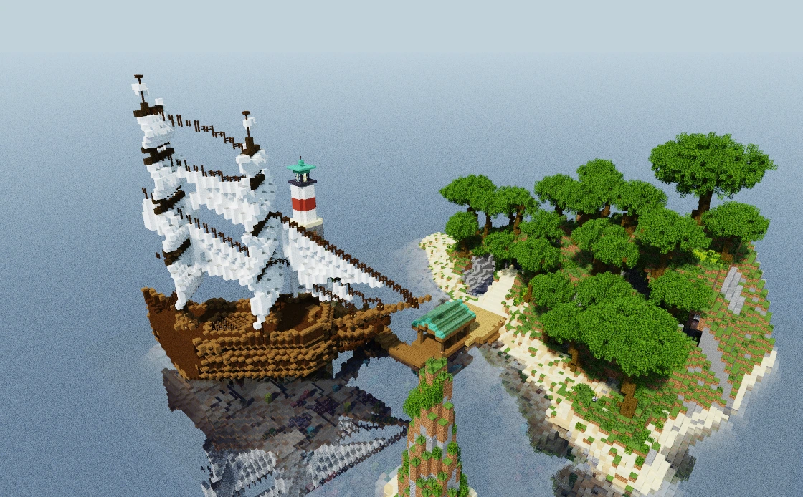
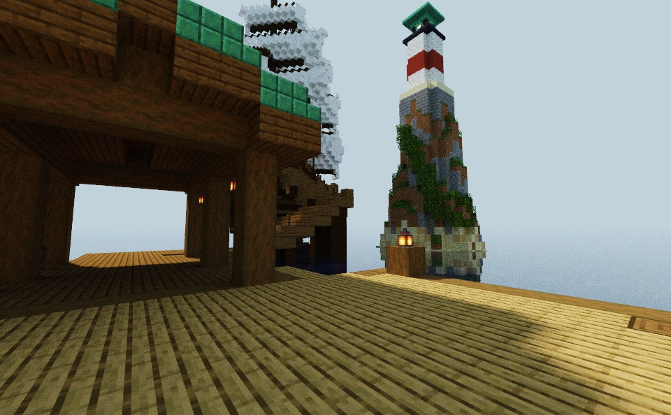
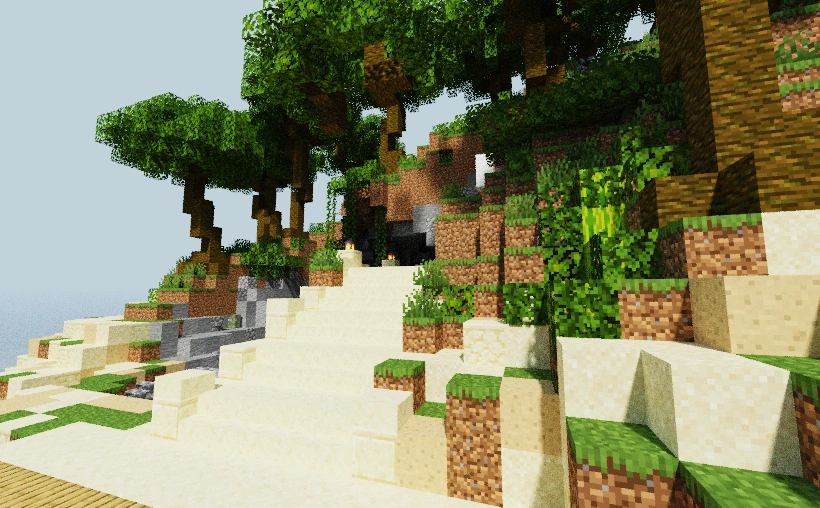

# Pirate Cove · Disasters

The original ship, forest and rock spires frame the playable waterfront. The gangway connects the wharf to the ship’s upper deck.

Players arrive on the open wharf. It has room to outrun the meteor warning. The green copper boat shed is within a short run when lightning starts.

The sandstone stair on the inland side leads to a refuge above the fog. Players can also reach high ground on the ship.

Chunky rendered the distributed Sponge schematic with the vanilla Java 1.21.11 assets. The ocean plane continues at the generator’s water level. Pirate Cove by GoldenOre, with contributions by AlmightyBread and adaptation by RusCrafting. [Map credits and source](../../../src/main/resources/arena-templates/disasters-coast-v1/CREDITS.md) · [CC BY-SA 4.0](https://creativecommons.org/licenses/by-sa/4.0/)
